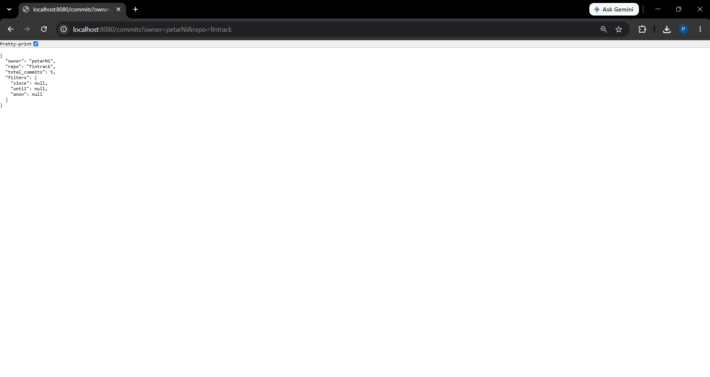
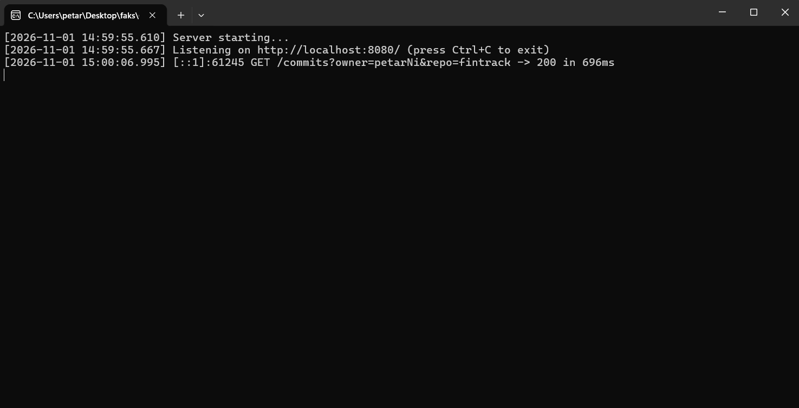
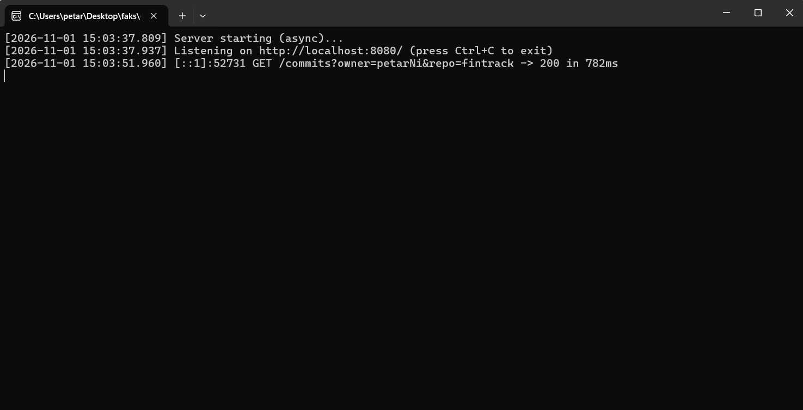
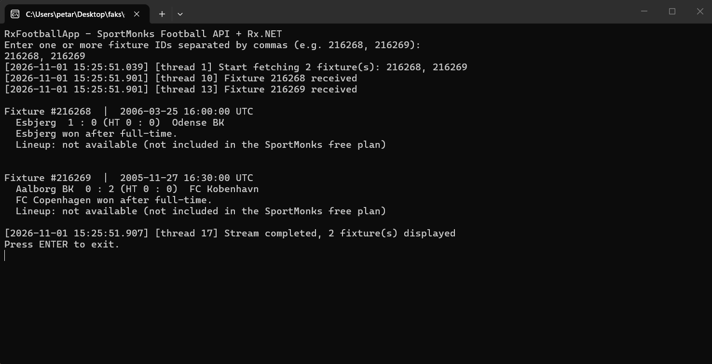

# Systems Programming in C#

Three console applications exploring multithreading, asynchronous programming and reactive streams in C#: a multithreaded HTTP server, its async/await rewrite, and a reactive client built with Rx.NET.


> Projects developed for the *Systems Programming* course at the Faculty of Electronic Engineering, University of Niš.

## Projects at a Glance

| # | Project | Concurrency model | External API |
|---|---------|-------------------|--------------|
| 1 | [Multithreaded HTTP server](#1-multithreaded-http-server) | `ThreadPool`, `SemaphoreSlim`, `lock` | GitHub REST API |
| 2 | [Asynchronous HTTP server](#2-asynchronous-http-server) | `async`/`await`, `Task.Run`, `SemaphoreSlim` | GitHub REST API |
| 3 | [Reactive football client](#3-reactive-football-client-rxnet) | Rx.NET, `ThreadPoolScheduler`, `NewThreadScheduler` | SportMonks Football API |

---

## 1. Multithreaded HTTP Server

A console web server built on `HttpListener` that returns the total number of commits in a GitHub repository, computed from the GitHub contributor statistics endpoint.




**How it works**

- Every incoming request is handed off to the **ThreadPool** (`ThreadPool.QueueUserWorkItem`), so the listener loop is never blocked
- A **`SemaphoreSlim`** limits the number of parallel calls to the GitHub API (default: 4)
- Successful responses are stored in a thread-safe **in-memory cache** (`ConcurrentDictionary`); repeated requests are served instantly without calling GitHub
- GitHub returns `202 Accepted` while it computes statistics, so the client **retries with a delay** before giving up with `504`
- Every request is logged with its status code and processing time to the console and to `logs/log-yyyy-MM-dd.txt`; file writes are synchronized with `lock`

**Endpoint**

```http
GET http://localhost:8080/commits?owner={owner}&repo={repo}
```

| Parameter | Required | Description |
|-----------|----------|-------------|
| `owner` | yes | Repository owner |
| `repo` | yes | Repository name |
| `since` | no | Count commits from this date (`yyyy-MM-dd`) |
| `until` | no | Count commits up to this date (`yyyy-MM-dd`) |
| `anon` | no | Include anonymous contributors (`true`/`false`) |
| `force` | no | `true` bypasses the cache |

**Example response**

```json
{
  "owner": "petarNi",
  "repo": "fintrack",
  "total_commits": 5,
  "filters": { "since": null, "until": null, "anon": null }
}
```

---

## 2. Asynchronous HTTP Server

The same server rewritten with the **Task Parallel Library** and **`async`/`await`**, so threads are no longer blocked while waiting for network I/O.



The first request takes ~780 ms (GitHub API call); every following identical request is served from the cache in 0 ms.

**What changed compared to project 1**

- Request handling runs as asynchronous tasks (`Task.Run` + `async`/`await`) instead of blocking ThreadPool work items
- Calls to GitHub use non-blocking I/O and `SemaphoreSlim.WaitAsync`
- Minimum ThreadPool size is raised at startup (`ThreadPool.SetMinThreads`) to handle bursts of requests
- Graceful shutdown with `CancellationToken`

Endpoint, parameters and response format are identical to project 1.

---

## 3. Reactive Football Client (Rx.NET)

A console app that fetches football match data from the **SportMonks Football API** using a reactive pipeline built with **Rx.NET**.



Two fixtures are fetched **in parallel** on different ThreadPool threads (10 and 13) in the same millisecond, and results are observed on a dedicated thread (17).

**How it works**

- The user enters one or more fixture IDs; they become an observable sequence
- Each ID is mapped to an asynchronous API call (`Observable.FromAsync`) that runs on the **`ThreadPoolScheduler`**, so all requests run concurrently
- Results are delivered on a **`NewThreadScheduler`**, separating I/O work from output
- Errors for a single fixture are handled with `Catch` and do not break the stream
- The full Rx lifecycle is used: `OnNext` (display fixture), `OnError`, `OnCompleted`
- Each log entry includes the managed thread ID, which makes the parallelism visible

**Displayed data:** home and away team, final and half-time score, match date and result. Lineups are shown when available (they are not included in the SportMonks free plan).

---

## Tech Stack

| Area | Technologies |
|------|--------------|
| Language | C# |
| Runtime | .NET Framework 4.7.2 (projects 1–2), .NET 8 (project 3) |
| Concurrency | ThreadPool, Task Parallel Library, `async`/`await`, `SemaphoreSlim`, `ConcurrentDictionary`, `lock` |
| Reactive | Rx.NET (`System.Reactive`) |
| Networking | `HttpListener`, `HttpWebRequest`, RestSharp |
| JSON | Newtonsoft.Json |

## Getting Started

### Prerequisites

- Visual Studio 2022 with the *.NET desktop development* workload
- [.NET 8 SDK](https://dotnet.microsoft.com/download/dotnet/8.0) (project 3)
- A free [SportMonks](https://www.sportmonks.com/) API token (project 3)

### Projects 1 and 2

1. Open `Projekat1/Zadatak24/Zadatak24.sln` or `Projekat2/Zadatak24_Async/Zadatak24_Async.sln`
2. Run the project (F5) – the server starts on `http://localhost:8080/`
3. Open in a browser:

   ```
   http://localhost:8080/commits?owner=dotnet&repo=runtime
   ```

> Both servers use port 8080, so run only one at a time.

### Project 3

1. Store your SportMonks token in an environment variable (once):

   ```bash
   setx SPORTMONKS_API_TOKEN "your_token"
   ```

2. Restart the terminal / Visual Studio, then run:

   ```bash
   cd Projekat3/RxFootballApp/RxFootballApp
   dotnet run
   ```

3. Enter fixture IDs, e.g. `216268, 216269`

## Project Structure

```text
systems-programming-csharp/
├── Projekat1/Zadatak24/            # Multithreaded HTTP server (ThreadPool)
├── Projekat2/Zadatak24_Async/      # Asynchronous HTTP server (async/await)
├── Projekat3/RxFootballApp/        # Reactive football client (Rx.NET)
│   └── RxFootballApp/
│       ├── Models/                 # FixtureInfo, PlayerInfo
│       ├── Services/               # SportMonks API client, logger
│       └── Rx/                     # Reactive pipeline
└── docs/screenshots/               # README images
```

## Author

**Petar Nikolić** – [@petarNi](https://github.com/petarNi)
